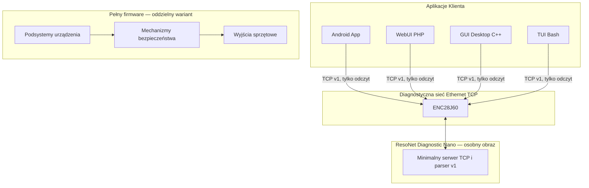

# 🌟 ResoNet-Nano: System Biorezonansu Open Source

<div align="center">


**Eksperymentalna platforma oprogramowania do generowania sygnałów i diagnostyki, z aplikacjami wieloplatformowymi.**

</div>

---

## 📋 Spis Treści

- [Szybka Instalacja](#-szybka-instalacja)
- [Opis Projektu](#-opis-projektu)
- [Architektura](#-architektura)
- [Sprzęt](#-sprzęt)
- [Firmware Arduino](#-firmware-arduino)
- [Aplikacje](#-aplikacje)
  - [GUI Desktop](#-gui-desktop)
  - [WebUI](#-webui)
  - [Android](#-android)
  - [TUI](#-tui)
- [Bezpieczeństwo](#-bezpieczeństwo)
- [Licencja](#-licencja)

---

## 🚀 Szybka Instalacja

Najszybszy sposób instalacji wszystkich komponentów:

```bash
# Pobierz installer
wget https://raw.githubusercontent.com/bartoszruta26-droid/Bioresonance/main/installer.sh
chmod +x installer.sh

# Uruchom installer
sudo ./installer.sh
```

### Opcje installera:
1. **Instalacja firmware Arduino** - kompilacja i upload do płytki
2. **Pobierz projekt z GitHub** - klonowanie repozytorium
3. **Instalacja zależności systemowych** - pakiety potrzebne do kompilacji
4. **Kompilacja GUI Desktop** - aplikacja C++/ImGui
5. **Instalacja WebUI** - Apache + PHP + pliki webui/
6. **Budowanie Android App** - aplikacja Kotlin na urządzenia mobilne
7. **Instalacja TUI** - terminalowy interfejs Bash
8. **Weryfikacja instalacji** - sprawdzenie wszystkich komponentów

---

## 🌟 Opis Projektu

**ResoNet-Nano** to eksperymentalny projekt open source wykorzystujący Arduino Nano. Zakresy częstotliwości, parametry wyjść i właściwości elektryczne wymagają niezależnych pomiarów i walidacji; nie są tu deklarowane jako potwierdzone parametry urządzenia.

### Kluczowe cechy:
- 🎯 **Generator sygnałów**: parametry PWM konfigurowane programowo; rzeczywiste parametry wymagają pomiaru
- 🔒 **Zabezpieczenia**: mechanizmy programowe; izolacja galwaniczna nie została tu zwalidowana
- 🌐 **Ethernet**: Diagnostyczny TCP przez ENC28J60 (UDP wyłączone)
- 💻 **Klienci diagnostyczni**: Android, WebUI (PHP), Desktop (C++), TUI (Python) — protokół v1, tylko odczyt

---

## 🏗️ Architektura



---

## 🔧 Sprzęt

### Wymagane komponenty:
- **Arduino Nano** (ATmega328P)
- **Moduł Ethernet** ENC28J60
- **ProbeHolder** - moduł izolacji i dopasowania impedancji
- **Antena EMF** - antena rezonator Schumanna lub płaska

### Połączenia:
| Arduino | Pin | Cel |
|---------|-----|-----|
| D10 | CS | ENC28J60 |
| D11 | MOSI | ENC28J60 |
| D12 | MISO | ENC28J60 |
| D13 | SCK | ENC28J60 |
| D9 | PWM | Wyjście na ProbeHolder |

📋 **Pełna dokumentacja:** [hardware.md](hardware.md)

---

## 🔧 Firmware Arduino

### Struktura projektu:
```
ResoNet_Nano/
├── ResoNet_Nano.ino
├── types.h
├── safety_system.*
├── pwm_engine.*
└── network_system.*
```

### Kompilacja:
```bash
# Zalecana kompilacja Nano z ograniczeniami pamięci
arduino-cli core install arduino:avr
arduino-cli lib install EthernetENC@2.0.5
bash ResoNet_Nano/build_nano.sh

# EthernetENC/TCP pozostaje domyślnie wyłączony.
# Przed włączeniem ustaw adresację w ResoNet_Nano/network_config.h.

# PlatformIO — tylko dla wariantu z Ethernet wyłączonym; dla Ethernet użyj build_nano.sh
cd ResoNet_Nano
platformio run --target upload
```

📋 **Szczegóły:** [arduino.md](arduino.md)

**Sieć diagnostyczna:** transport ENC28J60/TCP jest domyślnie wyłączony. Aby go włączyć, skonfiguruj adresację w `ResoNet_Nano/network_config.h`, ustaw `RESONET_ENABLE_ETHERNET` na `1` i zainstaluj EthernetENC `2.0.5`. Protokół v1 udostępnia wyłącznie diagnostykę; nie zawiera zdalnych poleceń aktywacji wyjść.

**Wariant oszczędny Flash:** `ResoNet_Diagnostic_Nano/` jest osobnym, minimalnym obrazem dla Nano + ENC28J60. Zawiera wyłącznie serwer TCP, parser v1 i odpowiedzi diagnostyczne. Nie zawiera PWM, sterowania efektorami ani pełnego kontrolera bezpieczeństwa, dlatego nie zastępuje pełnego firmware. CI pilnuje limitu 20 000 B Flash i 1 200 B RAM dla tego wariantu; wynik kompilacji musi być potwierdzony w zadaniu CI.

---

## 🖥️ Aplikacje

### 🎮 GUI Desktop (C++/ImGui)

Aplikacja desktopowa C++/Dear ImGui z negocjacją HELLO v1 i odczytem STATUS. Tryb wyłącznie diagnostyczny — brak sterowania wyjściami.

**Wymagania:**
```bash
sudo apt install cmake libsdl2-dev libgl1-mesa-dev
```

**Kompilacja:**
```bash
cd gui
mkdir build && cd build
cmake ..
make
./resonet_gui
```

📋 **Więcej:** [gui/README.md](gui/README.md)

---

### 🌍 WebUI (PHP/Apache)

Panel diagnostyczny przez przeglądarkę. Otwórz `webui/index.html`; stary interfejs tekstowy i endpoint `api.php` są wyłączone.

**Instalacja:**
```bash
sudo apt install apache2 php php-sockets
sudo cp -r webui/* /var/www/html/bioresonance/
sudo systemctl restart apache2
```

**Dostęp:** `https://localhost/bioresonance/` (po skonfigurowaniu TLS w Apache).

📋 **Więcej:** [webui/README.md](webui/README.md)

---

### 📱 Android (Kotlin)

Aplikacja mobilna na urządzenia z Androidem.

**Wymagania:**
- Android Studio Arctic Fox+
- JDK 17
- Android SDK 30+

**Budowanie:**
```bash
cd android_app
./gradlew assembleDebug
# APK: android_app/app/build/outputs/apk/debug/app-debug.apk
```

📋 **Więcej:** [android_app/README.md](android_app/README.md)

---

### 💻 TUI (Bash)

Terminalowy klient diagnostyczny Python 3; wysyła wyłącznie HELLO, PING i STATUS_REQ.

**Uruchomienie:**
```bash
cd bash_tui
chmod +x bioresonance_tui.sh
./bioresonance_tui.sh
```

📋 **Więcej:** [bash_tui/README.md](bash_tui/README.md)

---

## ⚕️ Bezpieczeństwo

⚠️ **WAŻNE**: To prototyp eksperymentalny. Nie potwierdzono zgodności z IEC 60601-1, izolacji 2500 V RMS ani bezpieczeństwa klinicznego. Nie używaj do terapii ludzi. Mechanizmy programowe nie zastępują niezależnych zabezpieczeń sprzętowych.

### Zasady bezpieczeństwa:
- Używaj tylko zasilaczy izolowanych
- Sprawdź izolację przed każdym użyciem
- Nie przekraczaj zalecanych czasów sesji
- Konsultuj się ze specjalistami

---

## 📜 Licencja

- **Oprogramowanie**: AGPLv3
- **Dokumentacja**: CC BY-NC-SA 4.0

---

<div align="center">

**Autor:** bartoszruta26-droid  
**Repozytorium:** https://github.com/bartoszruta26-droid/Bioresonance

</div>
